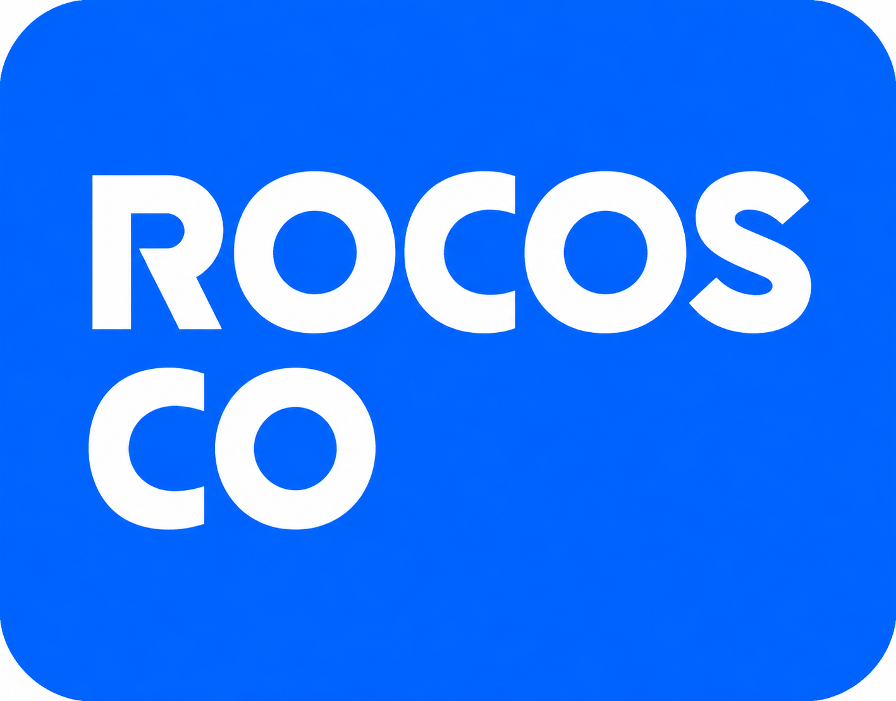

<div align="center">
  
  <h1>ROCOS-CO</h1>
  <blockquote>The CANopen Master for ROCOS</blockquote>
</div>

ROCOS-CO 是 ROCOS 控制器的 CANopen 主站。它作为独立进程运行，通过 Linux SocketCAN 与驱动器通信，通过 rocos-shm v2 与 ROCOS-App 交换过程数据。App 按 SHM ID 连接，继续负责关节绑定、单位换算和运动指令。主站独立读取自己的 `co.yaml`。

**验证状态**　首版面向六个 ZeroErr eRob 关节，采用 CiA 402 周期同步位置模式（CSP），目标周期为 8 ms（125 Hz）。M1–M4 已完成软件验证，包括真实 App 与六个虚拟 CANopen 节点的闭环联调。六轴在同一 SYNC 锁存、最坏延迟、漏拍和机械停稳时间仍待 M5 实测。[软件联调报告](docs/validation/m4/README.md) · [六轴台架记录](docs/validation/m5/README.md)

## 快速开始

在 Ubuntu 22.04 x86_64 上克隆项目并初始化两个锁定提交的子模块。安装脚本通过 apt 安装 C/C++ 工具链、CMake、Ninja、yaml-cpp 开发包以及 CAN 调试工具，普通用户直接执行即可。

```bash
git clone --recurse-submodules https://github.com/rocos-sia/rocos-co.git
cd rocos-co
./scripts/install-deps-ubuntu-22.04.sh
```

已有工作副本可用 `git submodule update --init --recursive` 补齐依赖。仓库提供 `debug` 和 `release` 两个 CMake 预设，下面的步骤可以在没有 CAN 适配器和驱动器的主机上完成。

```bash
cmake --preset release
cmake --build --preset release --parallel 2
ctest --preset release --output-on-failure
./build/release/bin/rocos_co_master --check-config --config config/erob_6axis/co.yaml
```

`--check-config` 打印有效配置、逐轴 PDO 偏移和总线预算，然后退出。六轴示例的预期结果为 Input 66 字节、Output 42 字节，每拍包含 1 帧 SYNC、6 帧目标和 12 帧反馈。[六轴配置](config/erob_6axis/co.yaml) · [构建与配置验收](docs/m1-validation.md)

## 配置与运行

| 六轴示例参数 | 用途 |
| --- | --- |
| `master.id: 2` | App 与主站约定的 SHM ID。联调示例在 App 侧使用 `robot.ecat_id` 选择同一实例。 |
| `master.node_id: 127` | 主站在 CANopen 总线上的 Node-ID。从站示例使用 1–6，对应 SHM 槽 0–5。 |
| `master.interface: can0`、`master.bitrate: 1000000` | 物理 SocketCAN 接口由部署侧预先配置并启用。启动时主站核对实际位速率。 |
| `master.cycle: 8000` | SYNC 周期，单位为微秒。每轴一帧 7 字节目标，两帧反馈分别为 6 和 5 字节。 |
| `master.state`、`slaves[].pdo_policy` | `preop` 用于维护，`op` 进入周期运行。`configure` 写入 PDO 映射并读回，`verify` 核对既有映射。 |

**虚拟总线联调。** 启用 vcan 测试后，独立的模拟从站、主站、真实 App 和只读监控可在隔离网络内验证六轴命令、反馈和故障处理。完整命令及所需 App 构建路径见 [M4 复验步骤](docs/validation/m4/README.md#复验)。

**实物台架。** 先按台架记录逐轴确认接线、身份、机械轴对应关系与 PDO 映射。准备好的维护配置应选择 `master.state: preop`；启动维护会话会发送 NMT 并设置心跳，PDO 写入由映射策略决定。将下方路径换成已核对的台架配置路径后运行。[台架操作与采集方法](docs/validation/m5/README.md)

```bash
./build/release/bin/rocos_co_master --config /path/to/bench/co.yaml
```

## 项目结构

| 路径 | 内容 |
| --- | --- |
| [src/](src/) | SocketCAN 传输、CANopen 协议栈适配、主站周期、SHM 交换与终端报告 |
| [config/](config/) · [od/](od/) | 部署 YAML、主站对象字典及其生成文件 |
| [3rdparty/](3rdparty/) · [cmake/](cmake/) | CANopenNode 与 rocos-shm 子模块、CMake 依赖集成 |
| [tests/](tests/) · [scripts/](scripts/) | 单元与跨进程测试、六轴模拟从站、依赖安装和台架抓包分析 |

## 开发文档

- 主站启动顺序、SYNC 时序、失联处理与 SHM 契约见[设计方案](docs/canopen-master-design.md)。各阶段的交付物与验收条件见[实施计划](docs/canopen-master-implementation-plan.md)。
- 软件验证的记录包含[总线抓包与故障注入](docs/validation/m2/README.md)、[SHM v2 与 SDO 邮箱](docs/validation/m3.md)和[六轴 App 联调](docs/validation/m4/README.md)。
- 安装 Doxygen 并完成 CMake 配置后，运行 `cmake --build build/release --target code-docs`，用浏览器打开 `build/release/code-docs/html/index.html`。[代码阅读入口](docs/code-overview.md) · [开发约定](AGENTS.md)

ROCOS-CO 自有代码采用 MIT 许可证。第三方依赖分别遵循各自的许可证。[项目许可证](LICENSE) · [CANopenNode](https://github.com/CANopenNode/CANopenNode) · [rocos-shm](https://github.com/rocos-sia/rocos-shm)
